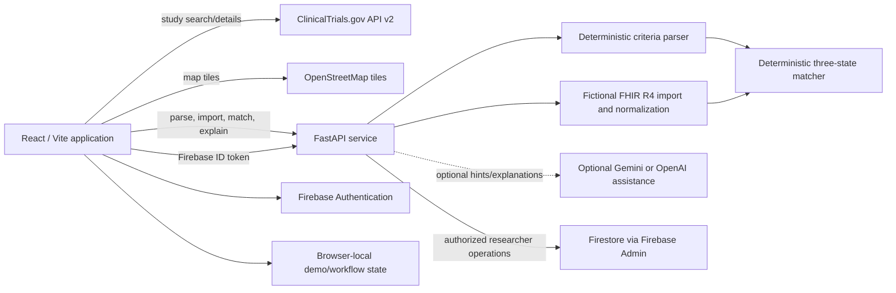

# Vitra
[https://hackru-cyan.vercel.app/] <<<<<<--------- link to run!

**A clinical-trial discovery and recruitment-workflow prototype that makes public study records and preliminary matching evidence easier to review.**

Vitra helps people explore real clinical-trial records and gives research teams a transparent, synthetic-data workflow for reviewing protocol criteria. It is a hackathon prototype, not a clinical decision system.

## The problem

Clinical-trial information is public, but study listings and eligibility text can be difficult to navigate. A person may not know what a trial involves or where it is running. Research teams may spend time organizing long criteria and comparing them with incomplete records. Missing information is easy to mistake for a negative or positive result.

## What Vitra does

Vitra brings public study information into a plain-language discovery experience and demonstrates how a research team could inspect criteria against **fictional** profiles. It preserves the source wording, provenance, and unknown information so reviewers can see what the prototype can and cannot support.

## Implemented features

- **Public website:** home, About, How it works, Clinical trial guide, Locations, and Research team pages.
- **Public study discovery:** search, study details, locations, eligibility text, official-record links, and study-summary PDF export using ClinicalTrials.gov API v2 data.
- **Location exploration:** an OpenStreetMap/Leaflet map and study-site context derived from public listings. Displayed sites are public record locations; they are not Vitra-affiliated clinics and do not verify researcher affiliation.
- **Patient and researcher workspaces:** role-based page layouts and sign-in. Firebase Authentication is used when configured; an explicitly local demo-auth path is available without Firebase.
- **Synthetic FHIR R4 patient workspace:** bundled fictional examples, JSON Bundle import, normalization/provenance display, and preliminary matching. Imports are processed in memory and are not saved to Firebase.
- **Eligibility parsing and matching:** conservative deterministic extraction and criterion-level `MET`, `NOT MET`, or `UNKNOWN` outcomes. Unclear, compound, or unsupported wording stays uncertain or is flagged for review.
- **AI Fit Review:** optional Gemini/OpenAI assistance can suggest criterion categories and summarize existing rule results. AI suggestions do not set or change deterministic criterion states.
- **Recruitment Bottleneck Intelligence:** counts per-criterion conflicts and unknowns over a synthetic cohort, with the cohort denominator visible. It is a synthetic-data demonstration, not an estimate from real recruitment operations.
- **Recruitment workflow prototype:** Data & Sites, Screening, AI Fit Review, Final Matches, and Outreach Center pages. The work-in-progress queue and review steps use browser-local storage; they do not contact participants.
- **Offline judging demo:** `/demo` uses bundled public study snapshots and fictional FHIR records to demonstrate the core parse, match, bottleneck, explanation, and local workflow sequence without live ClinicalTrials.gov or LLM calls.

## Architecture and data flow



**Typical data flow:** the browser retrieves a public study record and retains its NCT ID, source URL, retrieval time, and source text. For supported matching workflows, the API parses eligibility wording into structured criteria, normalizes one synthetic FHIR Bundle when supplied, then applies deterministic rules to each supported criterion. The response includes the source criterion, evidence, provenance where available, status counts, missing information, and a disclaimer. Optional AI assistance can add reviewer hints or a plain-language summary after the deterministic result exists.

The `/demo` path is separate: it asks the local API to evaluate one of three bundled ClinicalTrials.gov snapshots against bundled fictional FHIR Bundles using a fixed demo evaluation date. It does not call a live trial API or an LLM.

## Technology

| Technology | Role in this repository |
| --- | --- |
| React 19, JavaScript, Vite 8 | Active web application in the repository root; local development server and production build. |
| FastAPI, Uvicorn, Pydantic | API routes, request validation, and structured response models. |
| Python rules engine | Conservative criteria extraction, FHIR R4 normalization, and deterministic criterion matching. |
| ClinicalTrials.gov API v2 | Public study search and details. A small dated snapshot set supports offline fallback and judging. |
| Firebase Authentication | Optional account authentication when the Vite Firebase web configuration is supplied. |
| Firebase Admin, Firestore | Server-side ID-token/custom-role checks and protected trial/finalist API operations. |
| Gemini / OpenAI | Optional structured suggestions and explanations. Provider keys stay in the backend environment. |
| Leaflet, OpenStreetMap | Public map display and map tiles. |
| Node test runner, Python `unittest`, Playwright | Unit/integration and browser workflow checks. |

The `frontend/` directory is an unused Vite starter. The runnable Vitra application is the root `index.html`, `src/main.jsx`, and root `package.json`.

## ClinicalTrials.gov data

`src/services/clinicalTrials.js` is the browser-side client for `https://clinicaltrials.gov/api/v2/studies`. It normalizes public titles, NCT identifiers, statuses, conditions, phases, eligibility text, and listed locations for the UI. Requests use a short in-memory cache and have a fallback to `backend/app/data/trial_snapshots.json` when a matching bundled record is available. The UI labels cached results with their retrieval time and links to the official record. Live source data can change; verify current details on ClinicalTrials.gov.

ClinicalTrials.gov listings are not a determination that a person qualifies or that a site is currently recruiting. Availability and eligibility must be confirmed with the study team.

## Synthetic patient generation and import

The three bundled FHIR R4 patient Bundles in `backend/app/data/synthetic_demo.json` are hand-authored fictional examples. They are not Synthea output and are not a representative clinical population. The interface also includes instructions for generating additional synthetic examples with [Synthea](https://github.com/synthetichealth/synthea).

The importer accepts **one Patient Bundle per upload** after the user confirms that the data is synthetic. It validates the FHIR Bundle shape, resolves supported patient references, extracts supported Condition, Medication, Procedure, and Observation resources, and preserves a SHA-256 source fingerprint with entry/path provenance. Personally identifying Patient fields are not returned in the normalized profile. Observation use is restricted by status, date, supported units, and freshness checks; unsupported or contradictory evidence stays unavailable. Imports are processed in memory and are not persisted to Firebase.

The synthetic-data guide is [backend/SYNTHETIC_DATA.md](backend/SYNTHETIC_DATA.md).

## Eligibility parser and matching

`backend/app/eligibility_parser.py` uses deterministic rules to recognize supported patterns such as age ranges, diagnoses, medication rules, laboratory thresholds, time windows, and selected prior treatments. Ambiguous compound logic and unsupported language is retained as uncertain/manual review instead of being reduced to a convenient fragment. The original source text is carried through for inspection.

`backend/app/eligibility_matcher.py` compares the parsed criteria with fields explicitly present in a synthetic profile. Each criterion is reported as:

- **MET:** the available synthetic evidence explicitly supports the criterion.
- **NOT MET:** the available evidence explicitly conflicts with the criterion.
- **UNKNOWN:** evidence is missing, unsupported, ambiguous, or not sufficient to decide.

Unknown is never silently counted as met. The overall category and ordering are review aids only; they are not eligibility, enrollment, diagnosis, or treatment decisions. An optional LLM can suggest category labels only when `use_ai` is enabled and can summarize already-computed results. Deterministic logic retains authority over criterion states.

## Recruitment Bottleneck Intelligence

The prototype evaluates each criterion against the same explicitly fictional cohort, counts `MET`, `NOT MET`, and `UNKNOWN`, and records the cohort size as the denominator. In the 12-profile researcher demonstration, each criterion's displayed burden is `NOT MET + UNKNOWN`; results are sorted by burden, then conflicts, then unknowns. The `/demo` judging workflow also aggregates the API's computed outcomes over its three fictional profiles.

This describes where the **synthetic examples** encounter conflicts or missing data. It is not a recruitment forecast, a measure of real-world bottlenecks, or evidence of improved recruitment.

## Setup

### Requirements

- Node.js **24.12 or newer** (see `package.json` engines).
- Python 3.11 or newer recommended for the backend dependencies.
- npm.

### Install and run

From the repository root:

```bash
npm ci
python -m pip install -r backend/requirements.txt
cp .env.example .env.local
cp backend/.env.example backend/.env
npm run dev
```

The combined launcher starts the local FastAPI service and Vite website, checks the backend workflow version, and keeps both attached to that terminal. Open the Local URL Vite prints. If an older Vitra server is already using port 8000, stop it before starting this project. On Windows, use `npm.cmd` in place of `npm`.

Firebase values in `.env.local` are blank in the template. Without them, sign-in uses a clearly labeled browser-local demo account; it is not a shared or production identity system. To use Firebase Authentication, fill in the Firebase web-app values and configure the backend service account and researcher custom claims. Do not commit `.env.local`, `backend/.env`, service-account files, or provider keys.

### Offline judging demo

The explicit demo mode uses bundled study and patient snapshots and does not require Firebase or an LLM key:

```bash
npm run demo
```

Open `/demo` on the Local URL printed in the terminal. The local Python API is still required. The cached study snapshot and demo evaluation date are labeled in the interface; the examples are fictional and the fixed evaluation date is defined in `backend/app/demo.py`.

### Environment variables

| Variable | Where | Purpose |
| --- | --- | --- |
| `VITE_FIREBASE_API_KEY`, `VITE_FIREBASE_AUTH_DOMAIN`, `VITE_FIREBASE_PROJECT_ID`, `VITE_FIREBASE_STORAGE_BUCKET`, `VITE_FIREBASE_MESSAGING_SENDER_ID`, `VITE_FIREBASE_APP_ID` | `.env.local` | Firebase Web SDK configuration. Firebase auth is enabled when the required web settings are present. |
| `VITE_API_URL` | `.env.local` | Browser-visible FastAPI base URL. The example points to `http://localhost:8000`; in dev, `/api` can use the Vite proxy. For production, set the deployed API URL. |
| `VITRA_API_PORT` | shell/process environment | Local API port; defaults to `8000`. |
| `VITRA_WEB_PORT` | shell/process environment | Vite dev server port; defaults to `5173`. |
| `VITRA_PYTHON` | shell/process environment | Python executable used by the combined launcher; defaults to `python`. |
| `GOOGLE_APPLICATION_CREDENTIALS` | `backend/.env` | Path to a Firebase Admin service-account JSON file for protected Firestore operations. Keep the file private. |
| `FIREBASE_PROJECT_ID` | `backend/.env` | Optional Firebase project ID for the backend. |
| `GEMINI_API_KEY`, `GEMINI_MODEL` | `backend/.env` | Optional Gemini assistance; Gemini is preferred when configured. |
| `OPENAI_API_KEY`, `OPENAI_MATCHING_MODEL`, `OPENAI_EXPLAINER_MODEL` | `backend/.env` | Optional OpenAI fallback and model settings. Never expose these through a `VITE_` variable. |
| `VITE_OSM_TILE_URL` | `.env.local` | Optional OpenStreetMap-compatible tile URL; defaults to the public OSM tile service. |

Templates: [`.env.example`](.env.example) and [`backend/.env.example`](backend/.env.example). The backend loads `backend/.env` at startup. Optional AI features fall back to deterministic rules or source excerpts when no provider is configured or a response cannot be safely used.

## Testing and build

Run checks from the repository root unless specified:

```bash
npm test
npm run build
npm run test:e2e
```

Python API and data tests:

```bash
cd backend
python -m unittest discover -s tests -v
```

The Playwright suite uses Chrome and isolated local ports (`5188` for Vite and `8018` for the API). It exercises the offline judging workflow, public/workspace routes, mobile layout, and selected regression cases. If setting `VITE_API_URL` locally, point it to `/api` for the Playwright proxy or otherwise ensure the test browser reaches the test API on port `8018`.

## Known limitations and safety

- This is a hackathon prototype. It has not been clinically validated and must not be used to decide eligibility, enrollment, diagnosis, or treatment.
- All patient examples are fictional. Do not upload real medical records. Synthetic attestation is a user assertion, not technical proof that a file is synthetic.
- The parser supports a limited set of patterns. Complex, compound, exception-heavy, and unsupported criteria require qualified human review.
- `MET`, `NOT MET`, and `UNKNOWN` are matching states for explicit supplied evidence, not medical conclusions. Missing evidence stays unknown.
- Optional generative-AI text can be wrong. Reviewer hints never replace deterministic states; verify explanations against cited source records.
- The demo has three cached public study records and a small fictional cohort. No population-level or real-world recruitment performance is measured.
- Recruitment-cycle context, queues, saved workflow actions, and local demo auth use browser storage in this prototype. They are not a production patient-record or cross-device persistence system. The offline demo sends no invitations.
- Firebase/Firestore production deployment, real account-role provisioning, access-control review, security review, and outbound communication are not complete production assurances. Backend researcher operations require Firebase ID tokens and the `researcher` custom claim.
- Map tiles and live ClinicalTrials.gov data require network access outside the offline `/demo` flow. Public records and locations may be incomplete or stale.

## Demo materials

- Local offline workflow: run `npm run demo`, then open `/demo`.
- QA notes and audited limitations: [QA_REPORT.md](QA_REPORT.md).
- Hackathon submission copy, pitch, and judge-facing feature highlights: [docs/HACKATHON_SUBMISSION.md](docs/HACKATHON_SUBMISSION.md).
- No hosted deployment URL or committed screenshot set is configured in this repository at the time of writing.

## Future improvements

- Expand deterministic criterion coverage with protocol-expert review and a maintained set of edge-case fixtures.
- Add a provenance-first review experience for ambiguous clauses, units, windows, exceptions, and compound logic.
- Connect the browser-local recruitment workflow to production-grade, role-scoped persistence and audited access controls.
- Validate security, privacy, usability, accessibility, and clinical workflow fit with qualified stakeholders before considering real records or operations.
- Add more cached trial snapshots and resilient refresh/update policies with clear source timestamps.
- Measure workflow usability in a governed pilot before making any claims about recruitment outcomes.
